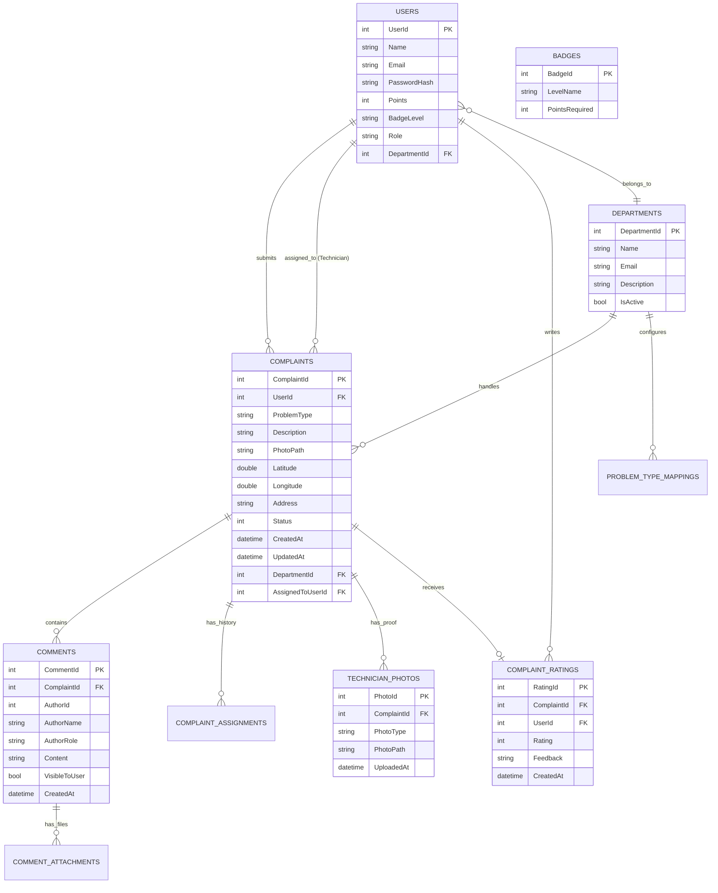

# System Design Document — JanSamadhan
**Comprehensive Architectural Blueprint, Technical Specifications & Design Decisions**

---

## 1. Executive Summary & Problem Context

### 1.1 Project Overview
**JanSamadhan** is an enterprise-grade, geo-aware, and gamified Civic Grievance Redressal and Field Operations Management Platform. It bridges the gap between citizens reporting public infrastructure anomalies (e.g., potholes, defunct streetlights, sewage blockages, bridge cracks) and municipal departments dispatching field technicians to resolve them.

### 1.2 Core Problem Statement
Conventional municipal grievance workflows suffer from:
1. **Opaque & Disconnected Channels:** Citizens file complaints via unmonitored email threads, hotlines, or physical desks, leading to lost tickets and lack of tracking.
2. **Duplicate Reporting Overheads:** Multiple citizens report the identical pothole or broken streetlight, wasting administrative triage bandwidth.
3. **Lack of Location & Visual Precision:** Text-only reports lack exact GPS coordinates and photographic proof, leading to misrouted field visits.
4. **Unmotivated & Untracked Workforce:** Field technicians lack incentive structures, streamlined job queues, and photographic resolution validation.
5. **Zero Macro Visibility:** Civic administrators lack real-time geospatial heatmaps and department SLA analytics.

### 1.3 The JanSamadhan Solution
* **Geolocated Ingestion:** Complaints are captured with precision latitude/longitude coordinates, photographic evidence, and automated department categorization.
* **Proximity & Duplicate Prevention:** Interactive Leaflet GIS mapping with dynamic radius queries detects nearby active complaints.
* **Automated & Manual Work Dispatch:** Problem types automatically map to specialized municipal departments (`Public Works`, `Traffic Management`, `Utilities`) with granular assignment history.
* **Two-Stage Proof of Resolution:** Technicians must upload verified before/in-progress and fixed photographs before closing tickets.
* **Gamification Engine:** Points and dynamic badge tiers (`Bronze`, `Silver`, `Gold`, `Platinum`, `Diamond`) drive technician productivity and citizen engagement.
* **Citizen Feedback & Transparency Loop:** 1-5 star ratings, feedback reviews, and multi-party threaded discussions.

---

## 2. Stakeholders & Role-Based Access Control (RBAC)

| Role / Actor | Description & Privileges | Primary Touchpoints |
|---|---|---|
| **Citizen (`User`)** | Authenticated public resident. Submits complaints with photo & GPS, monitors status, chats via comments, views nearby map, rates resolved complaints, earns civic points. | Complaint Portal, Nearby Map, Ticket History, Star Rating modal |
| **Field Technician (`Technician`)** | Municipal field worker assigned to a specific department. Claims open work orders, uploads in-progress & completion photos, marks tasks fixed, earns gamified points/badges, tracks leaderboard. | Technician Dashboard, Available Work Queue, Dual-Photo Upload, Technician Scoreboard |
| **Department Manager (`DepartmentManager`)** | Oversees specific department workflows. Reassigns tickets, monitors technician workloads, reviews department SLA metrics. | Department Queue, Assignment Manager, SLA Reports |
| **System Administrator (`Admin`)** | Superuser overseeing the entire municipality. Manages departments, users, problem type routing rules, views city-wide geospatial heatmaps, audits system logs. | Admin Dashboard, Interactive Geospatial GIS Map, Master Data CRUD, Global Scoreboard |

---

## 3. High-Level System Architecture

JanSamadhan follows a clean, modular **Multi-Tier Model-View-Controller (MVC)** architectural pattern built on the high-performance **ASP.NET Core 8.0** runtime.

```
┌─────────────────────────────────────────────────────────────────────────────────────────────┐
│                                   CLIENT / PRESENTATION TIER                                │
│   ┌────────────────────────┐   ┌────────────────────────┐   ┌───────────────────────────┐   │
│   │ Razor Views (.cshtml)  │   │ Bootstrap 5 + CSS3     │   │ Leaflet.js / OpenStreetMap│   │
│   │ Responsive UI Forms    │   │ Modern Theme & Alerts  │   │ GeoJSON Map Rendering     │   │
│   └───────────┬────────────┘   └───────────┬────────────┘   └─────────────┬─────────────┘   │
└───────────────┼────────────────────────────┼──────────────────────────────┼─────────────────┘
                │ HTTP/HTTPS                 │ Form Submissions / AJAX      │ GeoJSON Requests
                ▼                            ▼                              ▼
┌─────────────────────────────────────────────────────────────────────────────────────────────┐
│                                 APPLICATION & LOGIC TIER (.NET 8)                           │
│  ┌───────────────────────────────────────────────────────────────────────────────────────┐  │
│  │ Kestrel Web Server & HTTP Request Middleware Pipeline                                 │  │
│  │ (ExceptionHandler ──► Hsts ──► HttpsRedirection ──► StaticFiles ──► Auth ──► Routing) │  │
│  └───────────────────────────────────────────┬───────────────────────────────────────────┘  │
│                                              ▼                                              │
│  ┌───────────────────────────────────────────────────────────────────────────────────────┐  │
│  │ MVC Controller Layer                                                                  │  │
│  │ ├── AccountController     (Auth, Cookie Tokens, Identity Registration)                │  │
│  │ ├── ComplaintController   (Ingestion, GPS Capture, File Upload, History)              │  │
│  │ ├── TechnicianController  (Work Queue, Dual-Photo Proof, Gamification Points)         │  │
│  │ ├── AdminController       (Triage, User/Dept CRUD, SLA Management)                    │  │
│  │ ├── MapController         (GeoJSON Streaming, Haversine Proximity Search)             │  │
│  │ └── CommentController     (Multi-Party Threaded Discussions)                          │  │
│  └───────────────────────────────────────────┬───────────────────────────────────────────┘  │
│                                              ▼                                              │
│  ┌───────────────────────────────────────────────────────────────────────────────────────┐  │
│  │ Core Services & Business Rules                                                        │  │
│  │ ├── IPasswordService / PasswordService (Salted PBKDF2 HMAC-SHA256 Encryption)         │  │
│  │ ├── State Machine Validator (Strict Complaint Status Transitions)                    │  │
│  │ ├── Auto-Dispatch Routing Engine (ProblemType ──► Department Mapping)                 │  │
│  │ └── Gamification Calculator (Points Aggregation ──► Dynamic Badge Progression)        │  │
│  └───────────────────────────────────────────┬───────────────────────────────────────────┘  │
└──────────────────────────────────────────────┼──────────────────────────────────────────────┘
                                               │ Strongly-Typed Entity Operations & LINQ
                                               ▼
┌─────────────────────────────────────────────────────────────────────────────────────────────┐
│                                 DATA ACCESS TIER (EF CORE 8)                                │
│  ┌───────────────────────────────────────────────────────────────────────────────────────┐  │
│  │ ApplicationDbContext                                                                  │  │
│  │ • Change Tracker & Unit of Work Pattern                                               │  │
│  │ • Fluent API Relationships, Foreign Keys & Cascade Execution Rules                     │  │
│  │ • Parameterized LINQ-to-SQL Query Generation (SQL Injection Immune)                   │  │
│  └───────────────────────────────────────────┬───────────────────────────────────────────┘  │
└──────────────────────────────────────────────┼──────────────────────────────────────────────┘
                                               │ ADO.NET Connection Pool / TDS Protocol
                                               ▼
┌─────────────────────────────────────────────────────────────────────────────────────────────┐
│                               DATABASE & STORAGE TIER (MS SQL SERVER)                       │
│  ┌───────────────────────────────────────────────────────────────────────────────────────┐  │
│  │ Relational Database (JanSamadhanDb)                                                   │  │
│  │ [Users] ──── [Complaints] ──── [Departments] ──── [ComplaintAssignments]              │  │
│  │   │              │                                                                    │  │
│  │ [Badges]   [TechnicianPhotos] ──── [Comments] ──── [ComplaintRatings]                 │  │
│  └───────────────────────────────────────────────────────────────────────────────────────┘  │
│  ┌───────────────────────────────────────────────────────────────────────────────────────┐  │
│  │ Physical File Storage (/wwwroot/uploads/)                                             │  │
│  │ Complaint photos, technician proof snapshots, GUID-isolated storage                   │  │
│  └───────────────────────────────────────────────────────────────────────────────────────┘  │
└─────────────────────────────────────────────────────────────────────────────────────────────┘
```

---

## 4. Deep-Dive: Technology Stack Breakdown

### 4.1 Technology Stack Matrix

| Layer | Technology | Version | Purpose |
|---|---|---|---|
| **Web Runtime & Framework** | ASP.NET Core MVC | .NET 8.0 LTS | Cross-platform, high-throughput, enterprise web host & controller engine |
| **Language** | C# | Version 12 | Strongly-typed, modern object-oriented language with pattern matching & async/await |
| **Data Access / ORM** | Entity Framework Core | 8.0.6 | Object-Relational Mapping, LINQ queries, schema migrations & change tracking |
| **Database Engine** | Microsoft SQL Server / LocalDB | 2022 / Express | ACID-compliant relational persistence, spatial queries, and foreign-key integrity |
| **GIS & Mapping Frontend** | Leaflet.js + OpenStreetMap | 1.9.x | Client-side map rendering, pin clustering, interactive geolocation drop |
| **UI Framework & Styling** | Razor (.cshtml) + Bootstrap 5 | 5.3.x | Server-rendered dynamic HTML, responsive flexbox/grid layout, mobile-first design |
| **Authentication & Session** | ASP.NET Core Cookie Auth | 8.0.6 | Secure, encrypted, HTTP-only claims-based session cookies |
| **Security & Cryptography** | PBKDF2 Key Derivation | HMAC-SHA256 | Cryptographically secure 10,000+ iteration key stretching with 128-bit random salts |

---

### 4.2 How Each Technology Works Internally

#### 1. ASP.NET Core 8 MVC Runtime & Kestrel
* **Kestrel Web Server:** An event-driven, asynchronous I/O web server based on Libuv/managed sockets. It listens on TCP ports, parses incoming HTTP/1.1 and HTTP/2 requests, and converts them into an `HttpContext`.
* **Middleware Pipeline (`Program.cs`):** Requests pass sequentially through configured middleware components:
  1. `UseExceptionHandler` & `UseHsts` — Catches unhandled runtime faults and enforces HTTPS Strict Transport Security.
  2. `UseHttpsRedirection` & `UseStaticFiles` — Serves CSS/JS/images directly without hitting controller logic.
  3. `UseRouting` — Evaluates route templates (`{controller=Home}/{action=Index}/{id?}`).
  4. `UseAuthentication` & `UseAuthorization` — Decrypts cookie claims and enforces `[Authorize(Roles = "...")]` attributes.
  5. `MapControllerRoute` — Instantiates the appropriate Controller using the built-in Dependency Injection (DI) container.

#### 2. Entity Framework Core 8 (EF Core)
* **Object-Relational Mapping (ORM):** Bridges C# domain classes (`Complaint`, `User`) to SQL relational tables without manual ADO.NET boilerplate.
* **LINQ Provider:** When a query like `_db.Complaints.Where(c => c.Status == ComplaintStatus.Pending).ToListAsync()` executes, EF Core's query compiler parses the Abstract Syntax Tree (AST) of the C# expression and translates it into optimized, parameterized T-SQL (`SELECT ... WHERE [c].[Status] = @__parsedStatus_0`).
* **Change Tracker & Unit of Work:** When entities are loaded or modified, EF Core maintains a snapshot of original values in memory. Calling `SaveChangesAsync()` wraps all pending inserts, updates, and deletes into a single atomic SQL transaction.

#### 3. Cryptographic Password Hashing (PBKDF2)
* **How it works in `PasswordService.cs`:**
  1. For every user registration, a cryptographically secure pseudo-random number generator (`RandomNumberGenerator.GetBytes(16)`) produces a unique 128-bit salt.
  2. `KeyDerivation.Pbkdf2` executes 10,000 iterations of HMAC-SHA256 across the plain password and salt to generate a 256-bit subkey.
  3. The salt and subkey are packed into a single Base64 string: `{Salt}:{Hash}`.
  4. During authentication, the stored salt is extracted, the candidate password is re-hashed with the identical salt and parameters, and the outputs are compared using constant-time comparison to prevent timing attacks.

#### 4. Leaflet.js & Geospatial GeoJSON Pipeline
* **Frontend Geolocation:** The browser uses the HTML5 Geolocation API (`navigator.geolocation.getCurrentPosition`) or interactive map clicks to capture `{ lat, lng }`.
* **Backend GeoJSON Streaming:** `MapController.MapData` formats complaints into a standardized RFC 7946 GeoJSON FeatureCollection (`type: "FeatureCollection"`, `geometry: { type: "Point", coordinates: [lng, lat] }`).
* **Leaflet Layer Rendering:** Leaflet consumes tile data from OpenStreetMap (OSM) servers and dynamically overlays SVG/Canvas map markers with custom popups and color-coded status badges.

---

### 4.3 Why This Tech Stack Was Chosen (Technical & Business Justifications)

#### 1. Why ASP.NET Core 8 instead of Node.js (Express) or Python (Django/Flask)?
* **Throughput & Performance:** .NET 8 consistently ranks among the fastest web frameworks in TechEmpower benchmarks due to native JIT compilation, Span<T> memory efficiency, and asynchronous socket handling.
* **Type Safety & Maintainability:** C# 12 is a strictly typed language. In municipal systems handling critical infrastructure, compile-time type verification prevents entire classes of runtime null/type errors common in dynamically typed Node.js/Python codebases.
* **Integrated Security & Batteries-Included Ecosystem:** Built-in AntiForgery tokens, Cookie/Claims authentication, and native DI eliminate the risk of integrating insecure 3rd-party npm packages.

#### 2. Why Server-Side Razor Views (MVC) instead of a Single Page Application (React/Angular)?
* **Instant First Contentful Paint (FCP):** Razor views are compiled into C# code and executed on the server, returning pure HTML/CSS. Mobile field workers on low-bandwidth 3G/4G networks do not need to download multi-megabyte JavaScript bundles before seeing their work dashboard.
* **Zero Client-Side State Desynchronization:** Complex authorization gates (e.g., hiding Admin tabs or disabling status dropdowns) are enforced securely on the server prior to HTML emission.
* **SEO & Accessibility:** Public complaint boards and portal landing pages are instantly indexable by web crawlers without SSR (Server-Side Rendering) overheads.

#### 3. Why Entity Framework Core 8 instead of Raw ADO.NET or Dapper?
* **Productivity & Schema Migrations:** EF Core migrations allow the database schema to evolve in sync with domain models safely across team environments using code-first migrations (`db.Database.Migrate()`).
* **SQL Injection Immunity:** Every LINQ query is automatically parameterized by default, completely neutralizing SQL injection attack vectors.
* **Relationship Graph Handling:** Complex eager-loading (`.Include(c => c.User).Include(c => c.Department).Include(c => c.TechnicianPhotos)`) is handled cleanly in a single readable line.

#### 4. Why Leaflet.js + OpenStreetMap instead of Google Maps API?
* **Zero Licensing Costs & Open-Source:** Google Maps API charges per-map-load after strict free quotas. JanSamadhan uses OpenStreetMap tiles via Leaflet.js, making the platform 100% cost-free and open for public municipal deployment.
* **Lightweight Footprint:** Leaflet is ~42KB of JavaScript, compared to Google Maps JS SDK which is >200KB.
* **Data Privacy:** OpenStreetMap does not track citizen or municipal officer locations for commercial advertising.

#### 5. Why Microsoft SQL Server instead of MongoDB (NoSQL)?
* **Relational Integrity:** Civic complaints require strict foreign key guarantees. A complaint *must* belong to an existing user; a technician photo *must* belong to an existing complaint. NoSQL document stores risk data anomalies and orphaned records.
* **ACID Transactions:** Financial point assignments, badge level upgrades, and ticket status changes must be atomic. SQL Server provides robust multi-table transactional guarantees.

---

## 5. Detailed Component & Subsystem Design

```
┌────────────────────────────────────────────────────────────────────────────────────────┐
│                                   JANSAMADHAN MODULES                                  │
├───────────────────┬───────────────────┬────────────────────┬───────────────────────────┤
│ 1. Identity &     │ 2. Complaint      │ 3. Field Work &    │ 4. Gamification &         │
│    Auth (RBAC)    │    Ingestion      │    Dual-Proof      │    Scoreboard             │
├───────────────────┼───────────────────┼────────────────────┼───────────────────────────┤
│ 5. Geospatial GIS │ 6. Citizen Loop & │ 7. Admin Triage &  │ 8. Audit & History        │
│    Engine         │    Rating         │    Analytics       │    Tracking               │
└───────────────────┴───────────────────┴────────────────────┴───────────────────────────┘
```

### 5.1 Subsystem 1: Identity & Authentication Module
* **Claims-Based Identity:** When a user logs in via `AccountController.Login`, their `UserId`, `Email`, `Name`, and `Role` (`User`, `Technician`, `Admin`, `DepartmentManager`) are serialized into a cryptographically signed cookie token.
* **Granular Policy Enforcement:** Controllers and Actions are decorated with role guards:
  * `[Authorize(Roles = "Admin")]` -> Restricts administrative operations.
  * `[Authorize(Roles = "Technician")]` -> Restricts work claiming and photo uploads.
  * `[Authorize(Roles = "User")]` -> Citizen submission and rating endpoints.

### 5.2 Subsystem 2: Complaint Ingestion & Auto-Routing Engine
* **Input Capture:** Title, Problem Type, Description, Photo, Address, Latitude, and Longitude.
* **Auto-Routing Logic:**
  1. Citizen selects problem type (e.g., `"Pothole"`, `"Streetlight"`, `"Water Disposal"`).
  2. The system queries `ProblemTypeMappings` to look up the pre-assigned department ID.
  3. The ticket is initialized with `Status = ComplaintStatus.Pending` and automatically assigned to the designated Department (`DepartmentId = mapping.DepartmentId`).
  4. An audit record is written to `ComplaintAssignments` logging the initial auto-dispatch timestamp.

### 5.3 Subsystem 3: Field Operations & Dual-Stage Proof Workflow
* **Lifecycle State Machine:**
  * `Pending` (0) ──► `InProgress` (1) ──► `Fixed` (2)
* **Two-Stage Visual Verification:**
  * A technician cannot mark a complaint as `Fixed` without first submitting two distinct timestamped photographs:
    1. **Work-in-Progress Photo (`PhotoType = "WorkInProgress"`):** Proves the technician is physically on-site and actively fixing the issue.
    2. **Fixed Resolution Photo (`PhotoType = "Fixed"`):** Proves the issue has been successfully resolved according to municipal standards.
  * Validation rule in `TechnicianController.MarkAsFixed`: Checks `_db.TechnicianPhotos.Count(p => p.ComplaintId == id) >= 2`.

```
                    ┌─────────────────────────┐
                    │ Citizen Creates Ticket  │
                    │   (Status = Pending)    │
                    └────────────┬────────────┘
                                 │
                                 ▼
                    ┌─────────────────────────┐
                    │ Auto-Assigned to Dept   │
                    │ (ProblemTypeMapping)    │
                    └────────────┬────────────┘
                                 │
                                 ▼
                    ┌─────────────────────────┐
                    │ Tech Claims Ticket &    │
                    │ Uploads Dual Photos     │
                    │ (Status = InProgress)   │
                    └────────────┬────────────┘
                                 │
                                 ▼
                    ┌─────────────────────────┐
                    │ Tech Marks as Fixed     │
                    │ (Status = Fixed)        │
                    └────────────┬────────────┘
                                 │
                    ┌────────────┴────────────┐
                    ▼                         ▼
         ┌─────────────────────┐   ┌─────────────────────┐
         │ +Points & Badge Up  │   │ Citizen Rates (1-5★)│
         │ to Technician       │   │ & Leaves Review     │
         └─────────────────────┘   └─────────────────────┘
```

### 5.4 Subsystem 4: Gamification & Badge Progression Engine
* **Technician Motivation:**
  * Resolving a complaint awards points to the technician's profile (`User.Points += 10`).
  * The system compares new point totals against the `Badges` configuration table:
    * **Bronze:** 10 Points
    * **Silver:** 30 Points
    * **Gold:** 60 Points
    * **Platinum:** 100 Points
    * **Diamond:** 150 Points
* **Public Scoreboards:**
  * `AdminController.TechnicianScoreboard`: Ranks field technicians by completed tasks and efficiency.
  * `AdminController.Scoreboard`: Ranks active citizens by reporting contributions to encourage community participation.

### 5.5 Subsystem 5: Geospatial Proximity & Duplicate Detection
* **Bounding Box Calculation in `MapController.Nearby`:**
  To detect duplicate complaints within a 200-meter radius of a reporting citizen without heavy spatial database indexing:
  $$\Delta \text{Lat} = \frac{\text{Radius (meters)}}{111,000}$$
  $$\Delta \text{Lng} = \frac{\text{Radius (meters)}}{111,000 \times \cos(\text{Lat} \times \frac{\pi}{180})}$$
* The system queries active tickets within `[Lat ± ΔLat, Lng ± ΔLng]` and computes euclidean/haversine distances, returning nearby complaints to the citizen before submission.

---

## 6. Database Schema & Entity-Relationship Design

### 6.1 Entity-Relationship Diagram (ERD)



### 6.2 Relational Integrity & Cascade Rules (in `ApplicationDbContext`)
* **User -> Complaints:** `Cascade` on citizen account deletion to prevent orphan complaints.
* **User -> AssignedComplaints:** `Restrict` deletion of technicians who have active work orders assigned.
* **Complaint -> Comments & Photos:** `Cascade` so that removing a test complaint cleanly purges its comment threads and photos.
* **Complaint -> ComplaintRating:** `Restrict` on rating removal to preserve audit history.

---

## 7. Security Architecture & Threat Modeling

| Threat / Vulnerability | Mitigation in JanSamadhan | Implementation Detail |
|---|---|---|
| **SQL Injection** | Parameterized LINQ queries | EF Core compiles all LINQ queries to parameterized `@p0` variables. No raw string SQL concatenation is permitted. |
| **Cross-Site Scripting (XSS)** | Razor Engine Contextual Encoding | Razor views automatically HTML-encode all `@Model` expressions. Untrusted user input cannot execute arbitrary script tags. |
| **Cross-Site Request Forgery (CSRF)** | Synchronizer Token Pattern | ASP.NET Core automatically issues and validates hidden `__RequestVerificationToken` inputs on all `@Html.AntiForgeryToken()` forms. |
| **Privilege Escalation** | Claims-based RBAC Authorization | Role claims are cryptographically encrypted inside the auth cookie and verified per request via `[Authorize(Roles = "...")]`. |
| **Credential Theft & Rainbow Tables** | PBKDF2 with Cryptographic Salts | Passwords are salted with 128-bit CSPRNG bytes and hashed with 10,000 iterations of HMAC-SHA256. |
| **Insecure Direct Object Reference (IDOR)** | Server-side Ownership Verification | `ComplaintController` and `TechnicianController` verify that `complaint.UserId == currentUserId` or `complaint.AssignedToUserId == technicianId` before mutating state. |

---

## 8. Scalability & Future Evolution Plan

```
Current Architecture (Monolithic MVC)
┌──────────────────────────────────────────────────────────┐
│ ASP.NET Core 8 Web App + Local /uploads + LocalDB/SQL    │
└──────────────────────────────────────────────────────────┘
                            │
                            ▼ Evolution Path (Cloud Scale)
┌──────────────────────────────────────────────────────────┐
│  Load Balancer (Nginx / Azure App Gateway)               │
│   ├── Web Node 1 (ASP.NET Core Web APIs)                 │
│   └── Web Node 2 (ASP.NET Core Web APIs)                 │
│  State & Media:                                          │
│   ├── Redis Distributed Cache (GeoJSON caching & tokens) │
│   ├── Azure Blob / AWS S3 (High-res photo storage & CDN) │
│   └── SQL Server with Spatial Indexing (STDistance GIS)  │
│  Background Jobs:                                        │
│   └── RabbitMQ / Hangfire (SLA Escalation & SMS Alerts)  │
└──────────────────────────────────────────────────────────┘
```

1. **Blob Storage Transition:** Decouple `/wwwroot/uploads` file system storage and route image streams directly to AWS S3 or Azure Blob Storage with CDN edge delivery.
2. **Spatial Indexing:** Upgrade SQL queries to SQL Server native `geography` spatial types with `SPATIAL INDEX` for sub-millisecond radius lookups over millions of coordinates.
3. **Background SLA Escalation Engine:** Integrate Quartz.NET or Hangfire to automatically escalate tickets to senior municipal managers if complaints remain `Pending` past 48 hours.
4. **Mobile Native Extension:** The existing MVC controllers can be complemented with lightweight REST API endpoints (`/api/v1/complaints`) to power native Android/iOS field worker apps.

---

## 9. Quick-Reference: How to Explain This Project (Interview / Viva Guide)

### 9.1 The 30-Second Elevator Pitch
> *"JanSamadhan is an enterprise-grade Civic Grievance Redressal platform built with ASP.NET Core 8, EF Core, and Leaflet GIS mapping. It automates how cities resolve civic problems like potholes and broken streetlights. Citizens submit GPS-tagged reports with photos, the system auto-routes them to specialized departments, and field technicians earn gamified points and badges by resolving issues with two-stage photographic proof. The entire workflow is backed by role-based security, proximity-based duplicate prevention, and real-time administrator heatmaps."*

### 9.2 Key Technical Questions & Answers

#### Q1: "Why did you build this in ASP.NET Core MVC instead of a React/Node stack?"
* **Answer:** *"ASP.NET Core 8 offers industry-leading throughput, native memory efficiency, and compile-time type safety via C#. For a municipal system used in the field by workers on variable mobile networks, server-side Razor views eliminate massive JavaScript bundle downloads, delivering instant page rendering. Furthermore, ASP.NET Core provides out-of-the-box protection against CSRF, XSS, and SQL injection without relying on dozens of fragmented npm libraries."*

#### Q2: "How does the system prevent fake or unresolved complaint closures?"
* **Answer:** *"We implemented a Two-Stage Proof of Resolution mechanism in `TechnicianController`. A technician cannot mark an issue as 'Fixed' without uploading both a 'Work-in-Progress' photo and a 'Fixed' completion photo. Furthermore, once marked fixed, the reporting citizen is prompted to provide a 1-to-5 star rating and review, creating an audit loop that holds field staff accountable."*

#### Q3: "How does the duplicate complaint detection work?"
* **Answer:** *"When a citizen drops a pin on the map, the client invokes `MapController.Nearby`, which runs a bounding box calculation based on standard geographic conversion (1 degree ≈ 111 km). The server retrieves active complaints within a 200-meter radius, calculates accurate distance vectors, and renders existing tickets on the citizen's map to prevent redundant reporting."*

#### Q4: "How is security handled across different user types?"
* **Answer:** *"We use Claims-based Cookie Authentication with Role-Based Access Control (RBAC). Passwords are never stored in plaintext; they are salted with 128-bit cryptographic salts and hashed via 10,000 iterations of PBKDF2 with HMAC-SHA256. Controllers use `[Authorize(Roles = "...")]` attributes, and every data mutation validates user identity claims on the server to prevent IDOR attacks."*

---

*Document compiled for the JanSamadhan Architectural Specification & Engineering Repository.*
